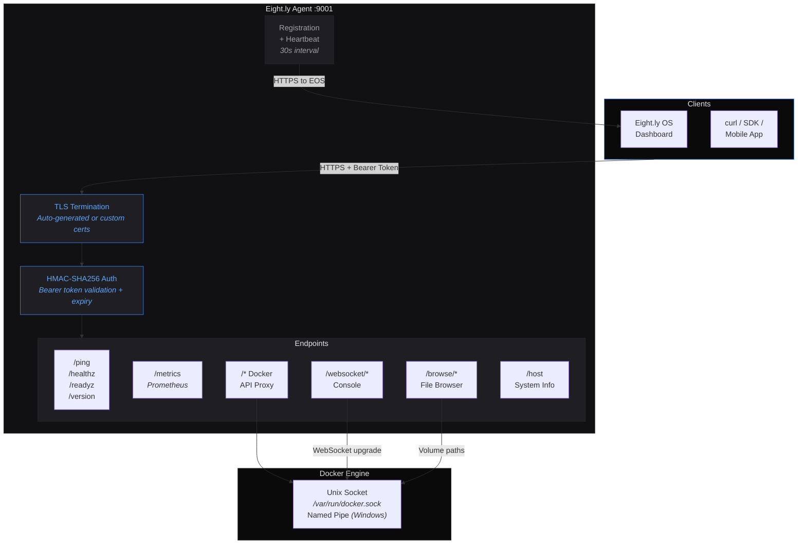

<div align="center">

# Eight.ly Agent

**Cross-platform Docker management daemon for [Eight.ly OS](https://eight.ly)**

[](https://go.dev)
[](https://hub.docker.com/r/smashingtags/eightly-agent)
[](LICENSE)

Run on every Docker host. Manage them all from one dashboard.

> **Repository status:** this repo (and its GHCR package) is **private** right now, so GitHub
> Releases, GHCR, Homebrew, and Scoop are not reachable publicly yet — those links will 404/403
> until the repo is made public. The only install path that works today is the Docker Hub image
> below, and it's a few months stale. See [Quick Start](#quick-start) for the current state of
> each method.

<br />


</div>

---

## Overview

Eight.ly Agent is a single Go binary that turns any Docker host into a managed node for Eight.ly OS. Deploy the agent on Linux, macOS, or Windows, point EOS at it, and get full container management, WebSocket console, file browsing, and system monitoring — all over authenticated TLS.

**~3,150 lines of Go. Four dependencies. Zero config files.**

### Key Capabilities

| | Feature | Description |
|---|---|---|
| :whale: | **Docker API Proxy** | Forwards authenticated requests to the local Docker socket over HTTPS |
| :tv: | **WebSocket Console** | Interactive container attach and exec via WebSocket |
| :open_file_folder: | **File Browser** | List, upload, download, delete, and rename files in Docker volumes |
| :bar_chart: | **Host Info** | Reports PCI devices, physical disks, and system metadata |
| :satellite: | **Registration** | Enrolls with Eight.ly OS using a one-time enrollment token and sends 30-second heartbeats |
| :closed_lock_with_key: | **Auto-TLS** | Serves a self-signed cert; pins the EOS server cert on first use (TOFU) |

---

## Multi-Host Fleet Management

Switch between local and remote hosts from the environment dropdown. Every container, on every host, from one UI.

<table>
<tr>
<td width="50%">

<p align="center"><sub>Local containers</sub></p>
</td>
<td width="50%">

<p align="center"><sub>Remote agent containers</sub></p>
</td>
</tr>
</table>

---

## Quick Start

### Docker Hub (the only method that works publicly today)

```bash
docker run -d \
  -v /var/run/docker.sock:/var/run/docker.sock:ro \
  -p 9001:9001 \
  -e EIGHTLY_AGENT_SECRET="your-shared-secret" \
  -e EIGHTLY_SERVER_URL="https://your-eos-server:8080" \
  -e EIGHTLY_ENROLL_TOKEN="your-enrollment-token" \
  smashingtags/eightly-agent:latest
```

> `EIGHTLY_SERVER_URL` is your Eight.ly OS dashboard URL — the agent register/heartbeat endpoints live on the same host and port EOS serves the UI from (default `8080`). Eight.ly OS generates a ready-to-paste `docker run` command with a one-time enrollment token under **Environments → Add host**.

> This image was last published 2026-05-21 — it predates the repo going private and may not reflect
> the current codebase. Verify `docker pull smashingtags/eightly-agent:latest` succeeds before relying
> on it; it is served from Docker Hub, not GHCR.

### Docker Compose

```bash
cp .env.example .env
# Edit .env with your shared secret and EOS server URL
docker compose up -d
```

A `docker-compose.yml` and `.env.example` are included in the repo.

### GHCR, Homebrew, Scoop, .deb/.rpm, and standalone binaries — not available yet

These all depend on this repo's GitHub Releases and container registry package, both of which
require the repo to be **public**. It's private today, so:

- `ghcr.io/imogenlabs/eightly-agent` — 403, no anonymous pull
- `brew install imogenlabs/tap/eightly-agent` and the `imogenlabs/scoop-eightly` bucket — the
  tap/bucket repos themselves are public, but their formula/manifest download from this repo's
  GitHub Releases, which 404s while the repo is private
- `.deb` / `.rpm` / standalone binary downloads from [Releases](https://github.com/imogenlabs/eightly-agent/releases) — 404, private repo

Once the repo is public these will work as documented in the [Install Methods](#install-methods) table below. Until then, use the Docker Hub image above, or build from source (see [CONTRIBUTING.md](CONTRIBUTING.md) — note that cloning also requires repo access while it's private).

---

## Configuration

Every flag has an equivalent environment variable. Env vars take precedence.

| Flag | Env Var | Default | Description |
|:-----|:--------|:--------|:------------|
| `--addr` | — | `0.0.0.0` | Listen address |
| `--port` | `AGENT_PORT` | `9001` | Listen port |
| `--secret` | `EIGHTLY_AGENT_SECRET` | — | HMAC shared secret for token validation |
| `--server-url` | `EIGHTLY_SERVER_URL` | — | EOS server URL for registration (must be `https` unless `--insecure-server-tls`) |
| `--enroll-token` | `EIGHTLY_ENROLL_TOKEN` | — | One-time enrollment token |
| `--state-path` | `EIGHTLY_STATE_PATH` | `/data/eightly-agent.json` | Registration state file |
| `--data` | `DATA_PATH` | `/data` | Data directory (TLS certs, state) |
| `--socket` | `DOCKER_SOCKET` | `/var/run/docker.sock` | Docker socket path |
| `--log-level` | `LOG_LEVEL` | `info` | Log level (debug, info, warn, error) |
| `--metrics` | `EIGHTLY_METRICS_ENABLED` | `false` | Enable Prometheus `/metrics` endpoint |
| `--server-ca` | `EIGHTLY_SERVER_CA` | — | CA cert path to verify the EOS server chain (in addition to TOFU leaf pin) |
| `--advertise-ip` | `EIGHTLY_ADVERTISE_IP` | — | IP to advertise instead of auto-detecting |
| `--tls-san` | `EIGHTLY_TLS_SANS` | — | Comma-separated extra SANs for the self-signed cert |
| `--allowed-origins` | `EIGHTLY_ALLOWED_ORIGINS` | — | Comma-separated WebSocket origin allowlist (empty = same-origin) |
| `--browse-read-only` | `EIGHTLY_BROWSE_READ_ONLY` | `false` | Serve the file browser read-only (reject upload/delete/rename) |
| `--insecure-no-auth` | `EIGHTLY_INSECURE_NO_AUTH` | `false` | Disable authentication (NOT for production) |
| `--insecure-server-tls` | — | `false` | Skip EOS server TLS verification + TOFU pinning (flag-only, NOT for production) |

---

## Windows Service

On Windows, the agent runs as a native Windows service — no terminal window, starts automatically on boot.

```powershell
# Install and start (run as Administrator)
eightly-agent.exe install
eightly-agent.exe start

# Manage
eightly-agent.exe status
eightly-agent.exe stop
eightly-agent.exe uninstall
```

| Subcommand | Description |
|:-----------|:------------|
| `install` | Registers the agent as a Windows service (automatic start) |
| `uninstall` | Stops and removes the service |
| `start` | Starts the service |
| `stop` | Sends a stop signal to the running service |
| `status` | Prints current service state (running, stopped, etc.) |

Configure via environment variables set in the system environment or the service registry. Default data path on Windows is `C:\ProgramData\eightly-agent`.

---

## Linux Service

The `.deb` and `.rpm` packages install a systemd unit automatically. For manual installs, copy the service file from the repo:

```bash
sudo cp deploy/eightly-agent.service /etc/systemd/system/
sudo systemctl daemon-reload
sudo systemctl enable --now eightly-agent
```

Override defaults with a drop-in:

```bash
sudo systemctl edit eightly-agent
```

```ini
[Service]
Environment=EIGHTLY_AGENT_SECRET=your-shared-secret
Environment=EIGHTLY_SERVER_URL=https://your-eos-server:8080
```

The service restarts automatically on failure (5-second delay) and starts after `docker.service`.

---

## API Reference

All endpoints require a valid Bearer token (HMAC-signed) **except** the unauthenticated probes `/ping`, `/healthz`, `/readyz`, and `/version`.

| Method | Path | Description |
|:-------|:-----|:------------|
| `GET` | `/ping` | Health check — returns `200 OK` (unauthenticated) |
| `GET` | `/healthz` | Liveness probe — always returns `200 {"status":"ok"}` (unauthenticated) |
| `GET` | `/readyz` | Readiness probe — returns `200` if Docker socket is reachable, `503` otherwise (unauthenticated) |
| `GET` | `/version` | Agent version + API version — returns `{"version":...,"api_version":"2"}` (unauthenticated) |
| `GET` | `/metrics` | Prometheus metrics (requires `--metrics` flag and auth) |
| `GET` | `/host` | PCI devices and physical disk info |
| `GET` | `/browse/ls` | List directory contents in a volume |
| `GET` | `/browse/get` | Download a file from a volume |
| `POST` | `/browse/put` | Upload a file to a volume |
| `DELETE` | `/browse/delete` | Delete a file or directory |
| `PUT` | `/browse/rename` | Rename a file or directory |
| `GET` | `/websocket/attach` | WebSocket container console (attach) |
| `GET` | `/websocket/exec` | WebSocket container console (exec) |
| `*` | `/*` | Docker API pass-through to local socket |

---

## Architecture



<details>
<summary><strong>Package Layout</strong></summary>

```
cmd/agent/
  main.go                       71 LOC — entry point, subcommands, signal handling
  service_windows.go           260 LOC — Windows service (install/uninstall/start/stop/status)
  service_other.go              32 LOC — no-op stubs for non-Windows platforms
internal/auth/jwt.go           127 LOC — HMAC shared-secret token validation middleware
internal/browse/browse.go      372 LOC — file browser (ls, get, put, delete, rename)
internal/config/
  config.go                    135 LOC — CLI flags + env var parsing
  defaults_windows.go           11 LOC — Windows default paths (named pipes, ProgramData)
  defaults_other.go             11 LOC — Linux/macOS default paths (unix socket, /data)
internal/hostinfo/
  hostinfo.go                   67 LOC — handler + shared types
  hostinfo_linux.go             62 LOC — PCI + disk detection (Linux, sysfs)
  hostinfo_darwin.go           130 LOC — system_profiler parsing (macOS)
  hostinfo_windows.go           91 LOC — PowerShell Get-PnpDevice / Get-PhysicalDisk (Windows)
internal/metrics/metrics.go     45 LOC — Prometheus counters/gauges
internal/proxy/docker.go       406 LOC — reverse proxy to Docker socket
internal/register/register.go  475 LOC — EOS registration + 30s heartbeat loop
internal/register/pin.go       106 LOC — TOFU server-cert leaf-SPKI pinning
internal/server/server.go      206 LOC — HTTP mux, TLS, graceful shutdown
internal/tlsutil/tls.go        118 LOC — self-signed cert generation
internal/websocket/websocket.go 369 LOC — WebSocket attach + exec handlers
                               ─────
                             ~3,150 LOC total
```

</details>

<details>
<summary><strong>Dependencies</strong></summary>

| Module | Purpose |
|:-------|:--------|
| `github.com/gorilla/websocket` | WebSocket upgrade for container console |
| `github.com/prometheus/client_golang` | Prometheus metrics (optional, `--metrics` flag) |
| `github.com/rs/zerolog` | Structured JSON logging |
| `golang.org/x/sys` | Windows service management (SCM API) |

</details>

---

## CI/CD

| Workflow | Trigger | What it does |
|:---------|:--------|:-------------|
| **CI** | Push/PR to `main`, `dev` | Lint (vet + staticcheck) → Test (race) → Build matrix (linux/amd64, linux/arm64, darwin/amd64, darwin/arm64, windows/amd64) |
| **Docker Publish** | Push to `main`, tags | Multi-arch build → GHCR + Docker Hub |
| **Release** | Tags (`v*`) or manual dispatch | Build 5 platform binaries + `.deb`/`.rpm` packages (amd64 + arm64) → GitHub Release with SHA256 checksums |

### Install Methods

> ⚠️ Every row below except Docker (Hub) requires this repo or its GHCR package to be public.
> Both are private today — see the [Quick Start](#quick-start) notes above before using these.

| Method | Platform | Command / Source |
|:-------|:---------|:-----------------|
| Docker (Hub) | Linux, macOS | `docker pull smashingtags/eightly-agent:latest` (works today; stale since 2026-05-21) |
| Docker (GHCR) | Linux, macOS | `docker pull ghcr.io/imogenlabs/eightly-agent:latest` — not reachable while the package is private |
| Homebrew | macOS, Linux | `brew install imogenlabs/tap/eightly-agent` — formula exists but its release asset 404s while the repo is private |
| Scoop | Windows | `scoop bucket add eightly https://github.com/imogenlabs/scoop-eightly && scoop install eightly-agent` — manifest exists but its release asset 404s while the repo is private |
| .deb package | Debian, Ubuntu | Download from [Releases](https://github.com/imogenlabs/eightly-agent/releases) (amd64, arm64) — not reachable while the repo is private |
| .rpm package | RHEL, Fedora | Download from [Releases](https://github.com/imogenlabs/eightly-agent/releases) (amd64, arm64) — not reachable while the repo is private |
| Windows service | Windows | Download `.exe` from [Releases](https://github.com/imogenlabs/eightly-agent/releases), then `eightly-agent.exe install && eightly-agent.exe start` — not reachable while the repo is private |
| Binary | Linux, macOS, Windows | Download from [Releases](https://github.com/imogenlabs/eightly-agent/releases) (5 platform builds) — not reachable while the repo is private |

## Verifying Releases

All release binaries are signed with [Sigstore cosign](https://sigstore.dev) and include SLSA build provenance. These commands apply once a release asset or image is actually reachable (see the private-repo notes above) — they verify the signature, not availability.

### Verify a binary

```bash
cosign verify-blob \
  --certificate eightly-agent-linux-amd64.crt \
  --signature eightly-agent-linux-amd64.sig \
  --certificate-identity-regexp 'https://github.com/smashingtags/eightly-agent' \
  --certificate-oidc-issuer https://token.actions.githubusercontent.com \
  eightly-agent-linux-amd64
```

### Verify a container image

```bash
cosign verify \
  --certificate-identity-regexp 'https://github.com/smashingtags/eightly-agent' \
  --certificate-oidc-issuer https://token.actions.githubusercontent.com \
  ghcr.io/imogenlabs/eightly-agent:1.0.0
```

### Verify SBOM

```bash
gh attestation verify eightly-agent-linux-amd64 \
  --owner smashingtags \
  --predicate-type https://spdx.dev/Document
```

### Verify build provenance

```bash
gh attestation verify eightly-agent-linux-amd64 \
  --owner smashingtags
```

---

## Security

Eight.ly Agent mediates access to the Docker daemon. Understanding the trust model is critical before deploying it.

**Who's trusted:** Anyone with a valid HMAC-signed Bearer token. A valid token grants full Docker API access on the host, which is equivalent to root access. Treat `EIGHTLY_AGENT_SECRET` with the same care as a root password.

**What the secret protects:** The shared secret (`EIGHTLY_AGENT_SECRET`) gates all Docker operations, file browser access, host info queries, and WebSocket console sessions. Without it, the agent rejects every request.

**What happens if it leaks:** An attacker with the secret can issue valid tokens, gaining full Docker API control on every host using that secret. They can create privileged containers, mount the host filesystem, and escalate to root. **Rotate the secret immediately** if you suspect compromise.

**Network exposure:**
- Bind the agent to a private interface or VPN -- never expose port 9001 to the public internet.
- The agent pins the EOS server's TLS certificate on first use (TOFU). The leaf SPKI fingerprint observed during the first successful registration is persisted in the agent state file and enforced on every later heartbeat and re-registration — a self-signed appliance server is trusted without a CA, but a swapped cert trips the pin. Pass `--server-ca` to *additionally* verify the server chain against a custom CA (the leaf pin still applies). `--insecure-server-tls` disables both verification and pinning — never use it in production.
- Place the agent behind a firewall that restricts access to your EOS server's IP.
- The agent's bearer token lasts 30 days, and the agent renews it on its own from day 15. If an agent was off long enough for its token to lapse, the Agents page marks it **Re-enroll needed**: generate an install command there and run it on the host. The agent uses the new enrollment token in place of the lapsed saved one.
- The state file holds the agent's bearer token, so the agent refuses to load it unless the file is 0600 and its directory 0700, both owned by the agent's uid. A new Docker volume directory starts at 0755; on start the agent tightens a directory it owns to 0700 and logs it. If it cannot (another owner, a read-only mount) it says so and keeps refusing, and the fix is `chown` the directory to the agent's uid (1000 in the image) and `chmod 700` it. The tightened directory is the state file's own, which by default is `/data`, the same directory as `--data` and the file browser root. If `/data` is shared with anything else, point `--state-path` at a private directory instead. A bind mount Docker creates for you (`-v $(pwd)/data:/data`) is owned by root, so the agent can neither tighten it nor save its state there; use a named volume or a directory owned by uid 1000.

For vulnerability reporting, see [SECURITY.md](SECURITY.md).

---

### License Commitment

This repository will remain Apache License 2.0 in perpetuity. Future versions of the EOS protocol may be implemented in closed-source server components, but the agent itself will not change license.

## License

Apache License 2.0 — see [LICENSE](LICENSE) for details.
