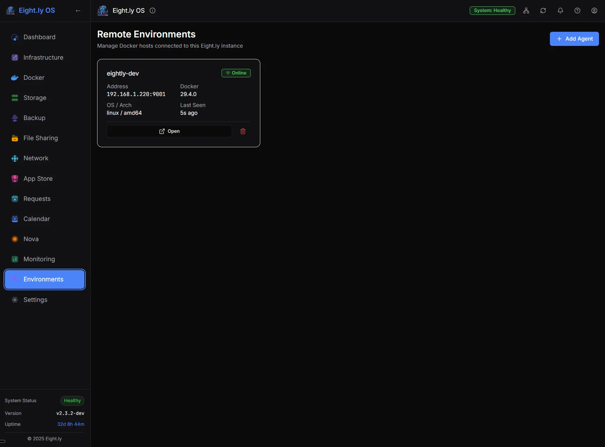
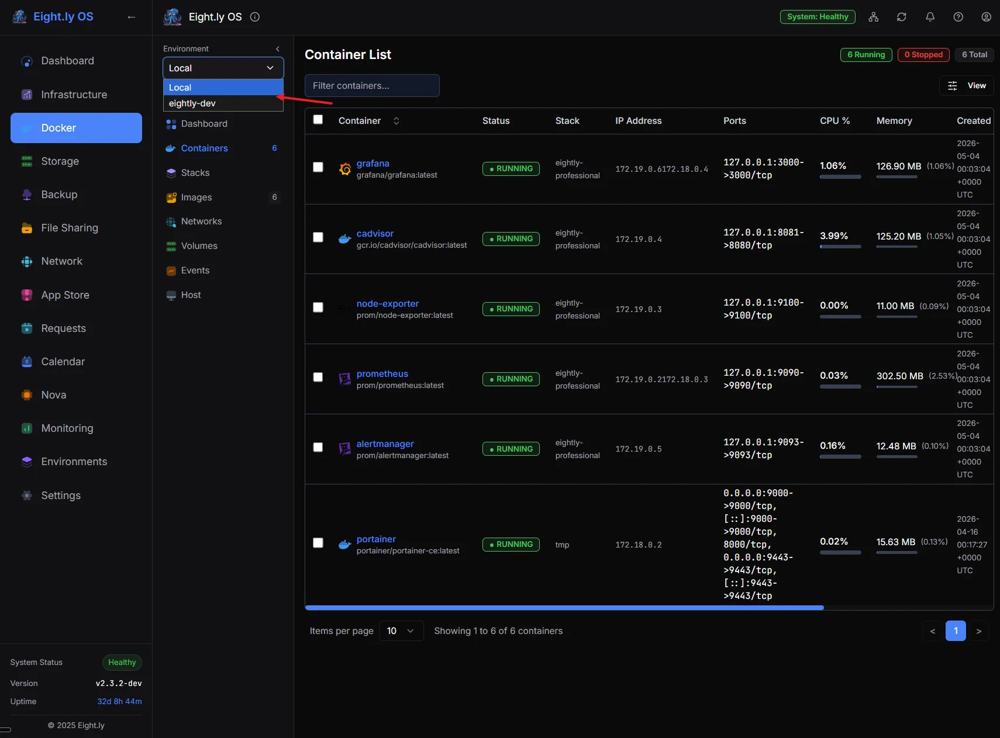
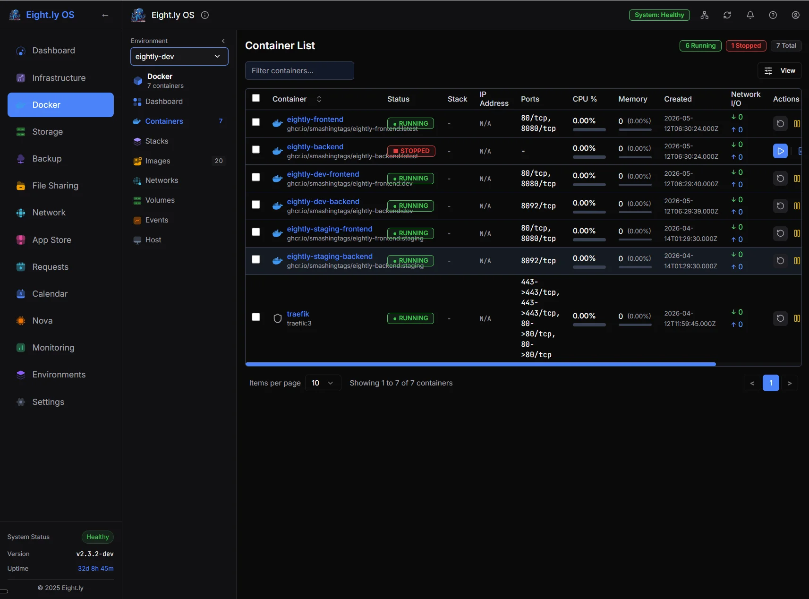

<div align="center">

# Eight.ly Agent

**Lightweight Docker management daemon for [Eight.ly OS](https://eight.ly)**

[](https://go.dev)
[](https://hub.docker.com/r/smashingtags/eightly-agent)
[](https://github.com/smashingtags/eightly-agent/pkgs/container/eightly-agent)
[](LICENSE)
[](https://github.com/smashingtags/homebrew-tap)

Run on every Docker host. Manage them all from one dashboard.

<br />



</div>

---

## Overview

Eight.ly Agent is a single Go binary that turns any Docker host into a managed node for Eight.ly OS. Deploy the agent, point EOS at it, and get full container management, WebSocket console, file browsing, and system monitoring — all over authenticated TLS.

**992 lines of Go. Two dependencies. Zero config files.**

### Key Capabilities

| | Feature | Description |
|---|---|---|
| :whale: | **Docker API Proxy** | Forwards authenticated requests to the local Docker socket over HTTPS |
| :tv: | **WebSocket Console** | Interactive container attach and exec via WebSocket |
| :open_file_folder: | **File Browser** | List, upload, download, delete, and rename files in Docker volumes |
| :bar_chart: | **Host Info** | Reports PCI devices, physical disks, and system metadata |
| :satellite: | **Registration** | Auto-registers with Eight.ly OS and sends 30-second heartbeats |
| :closed_lock_with_key: | **Auto-TLS** | Generates self-signed certificates if none are provided |

---

## Multi-Host Fleet Management

Switch between local and remote hosts from the environment dropdown. Every container, on every host, from one UI.

<table>
<tr>
<td width="50%">

<p align="center"><sub>Local containers</sub></p>
</td>
<td width="50%">

<p align="center"><sub>Remote agent containers</sub></p>
</td>
</tr>
</table>

---

## Quick Start

### Docker (recommended)

```bash
docker run -d \
  -v /var/run/docker.sock:/var/run/docker.sock \
  -p 9001:9001 \
  -e EIGHTLY_AGENT_SECRET="your-shared-secret" \
  -e EIGHTLY_SERVER_URL="https://your-eos-server:7001" \
  ghcr.io/smashingtags/eightly-agent:latest
```

> Also on Docker Hub: `docker pull smashingtags/eightly-agent:latest`

### Binary

```bash
make build
./build/eightly-agent \
  --secret "your-shared-secret" \
  --server-url "https://your-eos-server:7001" \
  --enroll-token "your-enrollment-token"
```

---

## Configuration

Every flag has an equivalent environment variable. Env vars take precedence.

| Flag | Env Var | Default | Description |
|:-----|:--------|:--------|:------------|
| `--port` | `AGENT_PORT` | `9001` | Listen port |
| `--secret` | `EIGHTLY_AGENT_SECRET` | — | HMAC shared secret for token validation |
| `--server-url` | `EIGHTLY_SERVER_URL` | — | EOS server URL for registration |
| `--enroll-token` | `EIGHTLY_ENROLL_TOKEN` | — | One-time enrollment token |
| `--state-path` | `EIGHTLY_STATE_PATH` | `/data/eightly-agent.json` | Registration state file |
| `--data` | `DATA_PATH` | `/data` | Data directory (TLS certs, state) |
| `--socket` | `DOCKER_SOCKET` | `/var/run/docker.sock` | Docker socket path |
| `--log-level` | `LOG_LEVEL` | `info` | Log level (debug, info, warn, error) |

---

## API Reference

All endpoints except `/ping` require a valid Bearer token (HMAC-signed).

| Method | Path | Description |
|:-------|:-----|:------------|
| `GET` | `/ping` | Health check — returns `200 OK` |
| `GET` | `/host` | PCI devices and physical disk info |
| `GET` | `/browse/ls` | List directory contents in a volume |
| `GET` | `/browse/get` | Download a file from a volume |
| `POST` | `/browse/put` | Upload a file to a volume |
| `DELETE` | `/browse/delete` | Delete a file or directory |
| `PUT` | `/browse/rename` | Rename a file or directory |
| `GET` | `/websocket/attach` | WebSocket container console (attach) |
| `GET` | `/websocket/exec` | WebSocket container console (exec) |
| `*` | `/*` | Docker API pass-through to local socket |

---

## Architecture

```
                  ┌─────────────────────┐
                  │   Eight.ly OS UI    │
                  │    (Dashboard)      │
                  └──────────┬──────────┘
                             │
                   HTTPS + Bearer Token
                             │
                  ┌──────────▼──────────┐
                  │  Eight.ly Agent     │
                  │     :9001           │
                  │                     │
                  │  ┌───────────────┐  │
                  │  │ Auth (HMAC)   │  │
                  │  │ TLS (auto)    │  │
                  │  │ Registration  │  │
                  │  │ Heartbeat     │  │
                  │  └───────────────┘  │
                  └──────────┬──────────┘
                             │
                        Unix Socket
                             │
                  ┌──────────▼──────────┐
                  │   Docker Daemon     │
                  │  /var/run/docker.sock│
                  └─────────────────────┘
```

<details>
<summary><strong>Package Layout</strong></summary>

```
cmd/agent/main.go             128 LOC — entry point, HTTP mux, TLS, graceful shutdown
internal/auth/jwt.go           65 LOC — HMAC shared-secret token validation middleware
internal/browse/browse.go     143 LOC — file browser (ls, get, put, delete, rename)
internal/config/config.go      51 LOC — CLI flags + env var parsing
internal/hostinfo/hostinfo.go  87 LOC — PCI device and physical disk detection
internal/proxy/docker.go       50 LOC — reverse proxy to Docker socket
internal/register/register.go 268 LOC — EOS registration + 30s heartbeat loop
internal/tlsutil/tls.go        75 LOC — self-signed cert generation
internal/websocket/ws.go      125 LOC — WebSocket attach + exec handlers
                               ─────
                               992 LOC total
```

</details>

<details>
<summary><strong>Dependencies</strong></summary>

| Module | Purpose |
|:-------|:--------|
| `github.com/gorilla/websocket` | WebSocket upgrade for container console |
| `github.com/rs/zerolog` | Structured JSON logging |

That's it. No frameworks, no ORM, no config libraries.

</details>

---

## CI/CD

| Workflow | Trigger | What it does |
|:---------|:--------|:-------------|
| **CI** | Push/PR to `main`, `dev` | Lint (vet + staticcheck) → Test (race) → Build matrix (5 platforms) |
| **Docker Publish** | Push to `main`, tags | Multi-arch build → GHCR + Docker Hub |
| **Release** | Tags (`v*`) | Build binaries + .deb + .rpm → GitHub Release with SHA256 checksums |

### Install Methods

| Method | Command |
|:-------|:--------|
| Docker (GHCR) | `docker pull ghcr.io/smashingtags/eightly-agent:latest` |
| Docker (Hub) | `docker pull smashingtags/eightly-agent:latest` |
| Homebrew | `brew install smashingtags/tap/eightly-agent` |
| Scoop (Windows) | `scoop bucket add eightly https://github.com/smashingtags/scoop-eightly && scoop install eightly-agent` |
| Debian/Ubuntu | Download `.deb` from [Releases](https://github.com/smashingtags/eightly-agent/releases) |
| RHEL/Fedora | Download `.rpm` from [Releases](https://github.com/smashingtags/eightly-agent/releases) |
| Binary | Download from [Releases](https://github.com/smashingtags/eightly-agent/releases) — Linux, macOS, Windows |

---

## License

Apache License 2.0 — see [LICENSE](LICENSE) for details.
