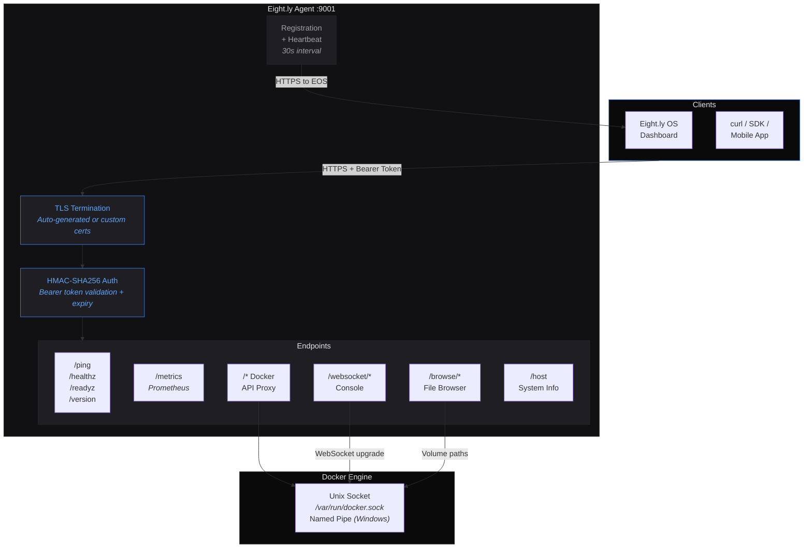

<div align="center">

# Eight.ly Agent

**Cross-platform Docker management daemon for [Eight.ly OS](https://eight.ly)**

[](https://go.dev)
[](https://github.com/smashingtags/eightly-agent/releases)
[](https://hub.docker.com/r/smashingtags/eightly-agent)
[](https://github.com/smashingtags/eightly-agent/pkgs/container/eightly-agent)
[](LICENSE)
[](https://github.com/smashingtags/homebrew-tap)

Run on every Docker host. Manage them all from one dashboard.

<br />


</div>

---

## Overview

Eight.ly Agent is a single Go binary that turns any Docker host into a managed node for Eight.ly OS. Deploy the agent on Linux, macOS, or Windows, point EOS at it, and get full container management, WebSocket console, file browsing, and system monitoring — all over authenticated TLS.

**~1,550 lines of Go. Three dependencies. Zero config files.**

### Key Capabilities

| | Feature | Description |
|---|---|---|
| :whale: | **Docker API Proxy** | Forwards authenticated requests to the local Docker socket over HTTPS |
| :tv: | **WebSocket Console** | Interactive container attach and exec via WebSocket |
| :open_file_folder: | **File Browser** | List, upload, download, delete, and rename files in Docker volumes |
| :bar_chart: | **Host Info** | Reports PCI devices, physical disks, and system metadata |
| :satellite: | **Registration** | Auto-registers with Eight.ly OS and sends 30-second heartbeats |
| :closed_lock_with_key: | **Auto-TLS** | Generates self-signed certificates if none are provided |

---

## Multi-Host Fleet Management

Switch between local and remote hosts from the environment dropdown. Every container, on every host, from one UI.

<table>
<tr>
<td width="50%">

<p align="center"><sub>Local containers</sub></p>
</td>
<td width="50%">

<p align="center"><sub>Remote agent containers</sub></p>
</td>
</tr>
</table>

---

## Quick Start

### Docker (recommended)

```bash
docker run -d \
  -v /var/run/docker.sock:/var/run/docker.sock \
  -p 9001:9001 \
  -e EIGHTLY_AGENT_SECRET="your-shared-secret" \
  -e EIGHTLY_SERVER_URL="https://your-eos-server:7001" \
  ghcr.io/smashingtags/eightly-agent:latest
```

> Also on Docker Hub: `docker pull smashingtags/eightly-agent:latest`

### Docker Compose

```bash
cp .env.example .env
# Edit .env with your shared secret and EOS server URL
docker compose up -d
```

A `docker-compose.yml` and `.env.example` are included in the repo.

### Homebrew (macOS / Linux)

```bash
brew install smashingtags/tap/eightly-agent
```

### Scoop (Windows)

```powershell
scoop bucket add eightly https://github.com/smashingtags/scoop-eightly
scoop install eightly-agent
```

### Debian / Ubuntu

Download the `.deb` from [Releases](https://github.com/smashingtags/eightly-agent/releases):

```bash
sudo dpkg -i eightly-agent_*.deb
sudo systemctl enable --now eightly-agent
```

### RHEL / Fedora

Download the `.rpm` from [Releases](https://github.com/smashingtags/eightly-agent/releases):

```bash
sudo rpm -i eightly-agent-*.rpm
sudo systemctl enable --now eightly-agent
```

### Binary

Download the binary for your platform from [Releases](https://github.com/smashingtags/eightly-agent/releases) (Linux amd64/arm64, macOS amd64/arm64, Windows amd64).

```bash
./eightly-agent \
  --secret "your-shared-secret" \
  --server-url "https://your-eos-server:7001" \
  --enroll-token "your-enrollment-token"
```

---

## Configuration

Every flag has an equivalent environment variable. Env vars take precedence.

| Flag | Env Var | Default | Description |
|:-----|:--------|:--------|:------------|
| `--port` | `AGENT_PORT` | `9001` | Listen port |
| `--secret` | `EIGHTLY_AGENT_SECRET` | — | HMAC shared secret for token validation |
| `--server-url` | `EIGHTLY_SERVER_URL` | — | EOS server URL for registration |
| `--enroll-token` | `EIGHTLY_ENROLL_TOKEN` | — | One-time enrollment token |
| `--state-path` | `EIGHTLY_STATE_PATH` | `/data/eightly-agent.json` | Registration state file |
| `--data` | `DATA_PATH` | `/data` | Data directory (TLS certs, state) |
| `--socket` | `DOCKER_SOCKET` | `/var/run/docker.sock` | Docker socket path |
| `--log-level` | `LOG_LEVEL` | `info` | Log level (debug, info, warn, error) |
| `--metrics` | `EIGHTLY_METRICS_ENABLED` | `false` | Enable Prometheus `/metrics` endpoint |

---

## Windows Service

On Windows, the agent runs as a native Windows service — no terminal window, starts automatically on boot.

```powershell
# Install and start (run as Administrator)
eightly-agent.exe install
eightly-agent.exe start

# Manage
eightly-agent.exe status
eightly-agent.exe stop
eightly-agent.exe uninstall
```

| Subcommand | Description |
|:-----------|:------------|
| `install` | Registers the agent as a Windows service (automatic start) |
| `uninstall` | Stops and removes the service |
| `start` | Starts the service |
| `stop` | Sends a stop signal to the running service |
| `status` | Prints current service state (running, stopped, etc.) |

Configure via environment variables set in the system environment or the service registry. Default data path on Windows is `C:\ProgramData\eightly-agent`.

---

## Linux Service

The `.deb` and `.rpm` packages install a systemd unit automatically. For manual installs, copy the service file from the repo:

```bash
sudo cp deploy/eightly-agent.service /etc/systemd/system/
sudo systemctl daemon-reload
sudo systemctl enable --now eightly-agent
```

Override defaults with a drop-in:

```bash
sudo systemctl edit eightly-agent
```

```ini
[Service]
Environment=EIGHTLY_AGENT_SECRET=your-shared-secret
Environment=EIGHTLY_SERVER_URL=https://your-eos-server:7001
```

The service restarts automatically on failure (5-second delay) and starts after `docker.service`.

---

## API Reference

All endpoints except `/ping` require a valid Bearer token (HMAC-signed).

| Method | Path | Description |
|:-------|:-----|:------------|
| `GET` | `/ping` | Health check — returns `200 OK` |
| `GET` | `/healthz` | Liveness probe — always returns `200 {"status":"ok"}` |
| `GET` | `/readyz` | Readiness probe — returns `200` if Docker socket is reachable, `503` otherwise |
| `GET` | `/metrics` | Prometheus metrics (requires `--metrics` flag and auth) |
| `GET` | `/host` | PCI devices and physical disk info |
| `GET` | `/browse/ls` | List directory contents in a volume |
| `GET` | `/browse/get` | Download a file from a volume |
| `POST` | `/browse/put` | Upload a file to a volume |
| `DELETE` | `/browse/delete` | Delete a file or directory |
| `PUT` | `/browse/rename` | Rename a file or directory |
| `GET` | `/websocket/attach` | WebSocket container console (attach) |
| `GET` | `/websocket/exec` | WebSocket container console (exec) |
| `*` | `/*` | Docker API pass-through to local socket |

---

## Architecture



<details>
<summary><strong>Package Layout</strong></summary>

```
cmd/agent/
  main.go                       67 LOC — entry point, subcommands, signal handling
  service_windows.go           257 LOC — Windows service (install/uninstall/start/stop/status)
  service_other.go              30 LOC — no-op stubs for non-Windows platforms
internal/auth/jwt.go            65 LOC — HMAC shared-secret token validation middleware
internal/browse/browse.go      143 LOC — file browser (ls, get, put, delete, rename)
internal/config/
  config.go                     51 LOC — CLI flags + env var parsing
  defaults_windows.go            9 LOC — Windows default paths (named pipes, ProgramData)
  defaults_other.go              9 LOC — Linux/macOS default paths (unix socket, /data)
internal/hostinfo/
  hostinfo.go                   35 LOC — handler + shared types
  hostinfo_linux.go             56 LOC — PCI + disk detection (Linux)
  hostinfo_darwin.go           118 LOC — system_profiler parsing (macOS)
  hostinfo_windows.go           85 LOC — WMI queries (Windows)
internal/proxy/docker.go        50 LOC — reverse proxy to Docker socket
internal/register/register.go  268 LOC — EOS registration + 30s heartbeat loop
internal/server/server.go      108 LOC — HTTP mux, TLS, graceful shutdown
internal/tlsutil/tls.go         75 LOC — self-signed cert generation
internal/websocket/websocket.go 125 LOC — WebSocket attach + exec handlers
                               ─────
                             ~1,550 LOC total
```

</details>

<details>
<summary><strong>Dependencies</strong></summary>

| Module | Purpose |
|:-------|:--------|
| `github.com/gorilla/websocket` | WebSocket upgrade for container console |
| `github.com/prometheus/client_golang` | Prometheus metrics (optional, `--metrics` flag) |
| `github.com/rs/zerolog` | Structured JSON logging |
| `golang.org/x/sys` | Windows service management (SCM API) |

</details>

---

## CI/CD

| Workflow | Trigger | What it does |
|:---------|:--------|:-------------|
| **CI** | Push/PR to `main`, `dev` | Lint (vet + staticcheck) → Test (race) → Build matrix (linux/amd64, linux/arm64, darwin/amd64, darwin/arm64, windows/amd64) |
| **Docker Publish** | Push to `main`, tags | Multi-arch build → GHCR + Docker Hub |
| **Release** | Tags (`v*`) or manual dispatch | Build 5 platform binaries + `.deb`/`.rpm` packages (amd64 + arm64) → GitHub Release with SHA256 checksums |

### Install Methods

| Method | Platform | Command / Source |
|:-------|:---------|:-----------------|
| Docker (GHCR) | Linux, macOS | `docker pull ghcr.io/smashingtags/eightly-agent:latest` |
| Docker (Hub) | Linux, macOS | `docker pull smashingtags/eightly-agent:latest` |
| Homebrew | macOS, Linux | `brew install smashingtags/tap/eightly-agent` |
| Scoop | Windows | `scoop bucket add eightly https://github.com/smashingtags/scoop-eightly && scoop install eightly-agent` |
| .deb package | Debian, Ubuntu | Download from [Releases](https://github.com/smashingtags/eightly-agent/releases) (amd64, arm64) |
| .rpm package | RHEL, Fedora | Download from [Releases](https://github.com/smashingtags/eightly-agent/releases) (amd64, arm64) |
| Windows service | Windows | Download `.exe` from [Releases](https://github.com/smashingtags/eightly-agent/releases), then `eightly-agent.exe install && eightly-agent.exe start` |
| Binary | Linux, macOS, Windows | Download from [Releases](https://github.com/smashingtags/eightly-agent/releases) (5 platform builds) |

## Verifying Releases

All release binaries are signed with [Sigstore cosign](https://sigstore.dev) and include SLSA build provenance.

### Verify a binary

```bash
cosign verify-blob \
  --certificate eightly-agent-linux-amd64.crt \
  --signature eightly-agent-linux-amd64.sig \
  --certificate-identity-regexp 'https://github.com/smashingtags/eightly-agent' \
  --certificate-oidc-issuer https://token.actions.githubusercontent.com \
  eightly-agent-linux-amd64
```

### Verify a container image

```bash
cosign verify \
  --certificate-identity-regexp 'https://github.com/smashingtags/eightly-agent' \
  --certificate-oidc-issuer https://token.actions.githubusercontent.com \
  ghcr.io/smashingtags/eightly-agent:1.0.0
```

### Verify SBOM

```bash
gh attestation verify eightly-agent-linux-amd64 \
  --owner smashingtags \
  --predicate-type https://spdx.dev/Document
```

### Verify build provenance

```bash
gh attestation verify eightly-agent-linux-amd64 \
  --owner smashingtags
```

---

## Security

Eight.ly Agent mediates access to the Docker daemon. Understanding the trust model is critical before deploying it.

**Who's trusted:** Anyone with a valid HMAC-signed Bearer token. A valid token grants full Docker API access on the host, which is equivalent to root access. Treat `EIGHTLY_AGENT_SECRET` with the same care as a root password.

**What the secret protects:** The shared secret (`EIGHTLY_AGENT_SECRET`) gates all Docker operations, file browser access, host info queries, and WebSocket console sessions. Without it, the agent rejects every request.

**What happens if it leaks:** An attacker with the secret can issue valid tokens, gaining full Docker API control on every host using that secret. They can create privileged containers, mount the host filesystem, and escalate to root. **Rotate the secret immediately** if you suspect compromise.

**Network exposure:**
- Bind the agent to a private interface or VPN -- never expose port 9001 to the public internet.
- The agent verifies the EOS server's TLS certificate by default (system trust store). Use `--server-ca` to pin a custom CA. **Breaking change (v1.x):** previous versions defaulted to `InsecureSkipVerify=true`; if you relied on that behavior, add `--insecure-server-tls` explicitly.
- Place the agent behind a firewall that restricts access to your EOS server's IP.

For vulnerability reporting, see [SECURITY.md](SECURITY.md).

---

### License Commitment

This repository will remain Apache License 2.0 in perpetuity. Future versions of the EOS protocol may be implemented in closed-source server components, but the agent itself will not change license.

## License

Apache License 2.0 — see [LICENSE](LICENSE) for details.
