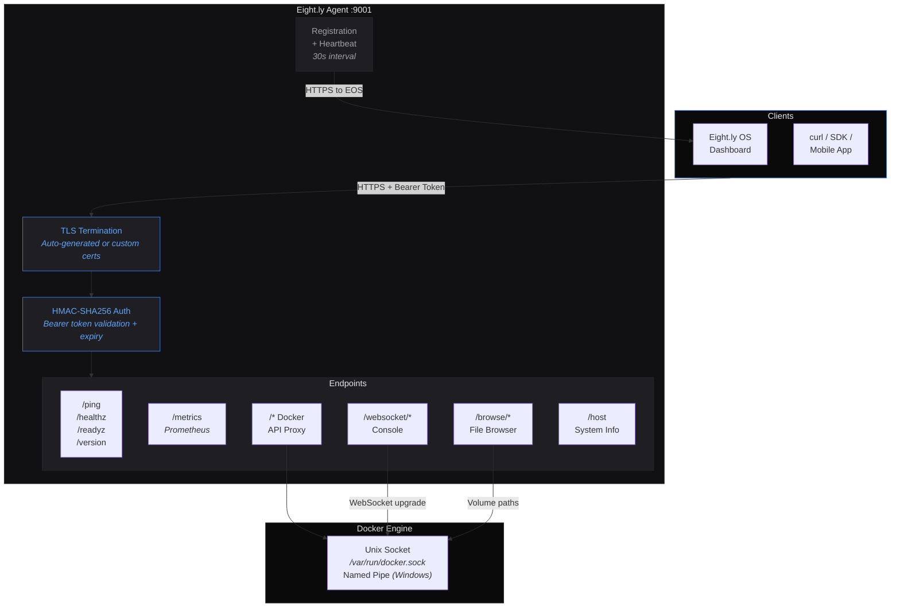

<div align="center">

# Eight.ly Agent

**Cross-platform Docker management daemon for [Eight.ly OS](https://eight.ly)**

[](https://go.dev)
[](https://github.com/imogenlabs/eightly-agent/pkgs/container/eightly-agent)
[](https://imogenlabs.github.io/eightly-agent/)
[](LICENSE)

**[Documentation](https://imogenlabs.github.io/eightly-agent/)** · [Releases](https://github.com/imogenlabs/eightly-agent/releases) · [Eight.ly OS](https://eight.ly)

Run on every Docker host. Manage them all from one dashboard.

<br />


</div>

---

## Overview

Eight.ly Agent is a single Go binary that turns any Docker host into a managed node for Eight.ly OS. Deploy the agent on Linux, macOS, or Windows, point EOS at it, and get full container management, WebSocket console, file browsing, and system monitoring — all over authenticated TLS.

**About 4,800 lines of Go. Four dependencies. Zero config files.**

### Key Capabilities

| | Feature | Description |
|---|---|---|
| :whale: | **Docker API Proxy** | Forwards authenticated requests to the local Docker socket over HTTPS |
| :tv: | **WebSocket Console** | Interactive container attach and exec via WebSocket |
| :open_file_folder: | **File Browser** | List, upload, download, delete, and rename files in Docker volumes |
| :bar_chart: | **Host Info** | Reports PCI devices, physical disks, and system metadata |
| :satellite: | **Registration** | Enrolls with Eight.ly OS using a one-time enrollment token and sends 30-second heartbeats |
| :closed_lock_with_key: | **Auto-TLS** | Serves a self-signed cert; pins the EOS server cert on first use (TOFU) |

---

## Multi-Host Fleet Management

Switch between local and remote hosts from the environment dropdown. Every container, on every host, from one UI.

<table>
<tr>
<td width="50%">

<p align="center"><sub>Local containers</sub></p>
</td>
<td width="50%">

<p align="center"><sub>Remote agent containers</sub></p>
</td>
</tr>
</table>

---

## Quick Start

### Docker

```bash
docker run -d --init --name eightly-agent --restart unless-stopped \
  -v /var/run/docker.sock:/var/run/docker.sock \
  --group-add "$(stat -c %g /var/run/docker.sock)" \
  -v eightly-agent-data:/data \
  -p 9001:9001 \
  -e EIGHTLY_AGENT_SECRET="your-shared-secret" \
  -e EIGHTLY_SERVER_URL="https://your-eos-server:8080" \
  -e EIGHTLY_ENROLL_TOKEN="your-enrollment-token" \
  ghcr.io/imogenlabs/eightly-agent:latest
```

The agent runs as uid 1000 and reaches Docker through the group that owns the socket. The image assumes GID 999; `--group-add` gives it your host's group, whatever its number.

The socket is mounted read-write on purpose. `:ro` only marks the socket file read-only, not the Docker API: anything that can open the socket can still create and start containers, so it protects nothing. The controls are the agent's signed-token check and its filter on the Docker requests it forwards, which refuses privileged containers, host namespaces and sensitive host mounts.

`--init` gives the container a process reaper. Images from this release on carry tini for the same job, and their health check is `eightly-agent healthcheck`. That is an in-process HTTPS GET of the agent's own `/healthz` that exits 0 or 1 and starts no child process. Do not override the health check with that command on an older image: before the subcommand existed, the agent ignored the extra word and would start a second agent.

> `EIGHTLY_SERVER_URL` is your Eight.ly OS dashboard URL — the agent register/heartbeat endpoints live on the same host and port EOS serves the UI from (default `8080`). Eight.ly OS generates a ready-to-paste `docker run` command with a one-time enrollment token under **Environments → Add host**.

The same image is mirrored on Docker Hub as `smashingtags/eightly-agent`.

### Docker Compose

```bash
cp .env.example .env
# Edit .env: your shared secret, EOS server URL and enrollment token
echo "DOCKER_GID=$(stat -c %g /var/run/docker.sock)" >> .env
docker compose up -d
```

A `docker-compose.yml` and `.env.example` are included in the repo. `DOCKER_GID` defaults to 999 when unset.

### Homebrew, Scoop, packages and binaries

```bash
brew install imogenlabs/tap/eightly-agent                     # macOS, Linux
scoop bucket add eightly https://github.com/imogenlabs/scoop-eightly
scoop install eightly-agent                                   # Windows
```

`.deb` and `.rpm` packages (amd64, arm64) and binaries for six platforms are on the
[Releases](https://github.com/imogenlabs/eightly-agent/releases) page. Every method is listed under
[Install Methods](#install-methods).

---

## Configuration

Every flag except `--addr`, `--insecure-server-tls` and `--version` has an equivalent environment variable. Env vars take precedence.

| Flag | Env Var | Default | Description |
|:-----|:--------|:--------|:------------|
| `--addr` | — | `0.0.0.0` | Listen address |
| `--port` | `AGENT_PORT` | `9001` | Listen port |
| `--secret` | `EIGHTLY_AGENT_SECRET` | — | HMAC shared secret for token validation |
| `--secret-file` | `EIGHTLY_AGENT_SECRET_FILE` | — | File holding the shared secret, instead of `--secret` (setting both is refused) |
| `--server-url` | `EIGHTLY_SERVER_URL` | — | EOS server URL for registration (must be `https` unless `--insecure-server-tls`) |
| `--enroll-token` | `EIGHTLY_ENROLL_TOKEN` | — | One-time enrollment token |
| `--state-path` | `EIGHTLY_STATE_PATH` | `eightly-agent.json` in the data directory | Registration state file |
| `--data` | `DATA_PATH` | `/data` | Data directory (TLS certs, state) |
| `--socket` | `DOCKER_SOCKET` | `/var/run/docker.sock` | Docker socket path |
| `--log-level` | `LOG_LEVEL` | `info` | Log level (debug, info, warn, error) |
| `--metrics` | `EIGHTLY_METRICS_ENABLED` | `false` | Enable Prometheus `/metrics` endpoint |
| `--server-ca` | `EIGHTLY_SERVER_CA` | — | CA cert path to verify the EOS server chain (in addition to TOFU leaf pin) |
| `--advertise-ip` | `EIGHTLY_ADVERTISE_IP` | — | IP to advertise instead of auto-detecting |
| `--tls-san` | `EIGHTLY_TLS_SANS` | — | Comma-separated extra SANs for the self-signed cert |
| `--allowed-origins` | `EIGHTLY_ALLOWED_ORIGINS` | — | Comma-separated WebSocket origin allowlist (empty = same-origin) |
| `--browse-read-only` | `EIGHTLY_BROWSE_READ_ONLY` | `false` | Serve the file browser read-only (reject upload/delete/rename) |
| `--insecure-no-auth` | `EIGHTLY_INSECURE_NO_AUTH` | `false` | Disable authentication (NOT for production) |
| `--insecure-server-tls` | — | `false` | Skip EOS server TLS verification + TOFU pinning (flag-only, NOT for production) |

`EIGHTLY_METRICS_ENABLED`, `EIGHTLY_BROWSE_READ_ONLY` and `EIGHTLY_INSECURE_NO_AUTH` take `true`/`false`, `1`/`0`, `yes`/`no` or `on`/`off`. Any other value stops the agent at startup with an error naming the variable. On Windows the defaults are `C:\ProgramData\eightly-agent` for data and `state.json` for the state file; see the [configuration guide](https://imogenlabs.github.io/eightly-agent/Configuration/).

---

## Windows Service

On Windows, the agent runs as a native Windows service — no terminal window, starts automatically on boot.

```powershell
# Install (run as Administrator). This creates C:\ProgramData\eightly-agent,
# closes it to everyone but SYSTEM and Administrators, and registers the
# service with --secret-file C:\ProgramData\eightly-agent\secret.
eightly-agent.exe install

# Write the shared secret into that file, then start
Set-Content -NoNewline -Path C:\ProgramData\eightly-agent\secret -Value 'your-shared-secret'
eightly-agent.exe start

# Manage
eightly-agent.exe status
eightly-agent.exe stop
eightly-agent.exe uninstall
```

| Subcommand | Description |
|:-----------|:------------|
| `install` | Registers the agent as a Windows service (automatic start) reading its secret from `--secret-file` (default `C:\ProgramData\eightly-agent\secret`) |
| `uninstall` | Stops and removes the service |
| `start` | Starts the service |
| `stop` | Sends a stop signal to the running service |
| `status` | Prints current service state (running, stopped, etc.) |

Keep the secret in the file, never in a Machine environment variable: every local user can read those. The service refuses to start when `EIGHTLY_AGENT_SECRET` is set alongside the file; remove an old one with `[Environment]::SetEnvironmentVariable('EIGHTLY_AGENT_SECRET', $null, 'Machine')`. `--secret-file` (or `EIGHTLY_AGENT_SECRET_FILE`) works on Linux and macOS too.

Windows ignores unix file modes, so the agent sets an explicit, protected access list (SYSTEM and Administrators full control, plus the agent's own account when it is run by hand; nothing inherited) on the data folder, the state file, the secret file and the TLS key and certificate when it creates or reuses them, and refuses to load the state, secret or key if any other account still has access. A folder is only re-permissioned when it holds nothing but the agent's files; elsewhere each file is protected on its own. Default data path on Windows is `C:\ProgramData\eightly-agent`.

---

## Linux Service

The `.deb` and `.rpm` packages install a systemd unit and create `/etc/eightly-agent/agent.env`, owned by root with mode `0600`. Put the agent's settings there, not in a `systemctl edit` drop-in: a drop-in is readable by every user on the host and `systemctl show` prints its values, secret included.

```bash
sudoedit /etc/eightly-agent/agent.env
```

```ini
EIGHTLY_AGENT_SECRET=your-shared-secret
EIGHTLY_SERVER_URL=https://your-eos-server:8080
EIGHTLY_ENROLL_TOKEN=eos_enroll_...
```

```bash
sudo systemctl enable --now eightly-agent
```

Values in `agent.env` override the unit's own `Environment=` lines. The package never overwrites an existing `agent.env`; an upgrade only resets its owner and mode. If you set the secret in a drop-in before, move it into `agent.env` and delete the drop-in.

For a manual install, create the user, the data directory and the settings file yourself, then copy the unit from the repo:

```bash
sudo useradd --system --no-create-home --shell /usr/sbin/nologin -G docker eightly-agent
sudo install -d -m 0700 -o eightly-agent -g eightly-agent /var/lib/eightly-agent
sudo install -d -m 0700 /etc/eightly-agent
sudo install -m 0600 /dev/null /etc/eightly-agent/agent.env   # then add the settings above
sudo cp deploy/eightly-agent.service /etc/systemd/system/
sudo systemctl daemon-reload
sudo systemctl enable --now eightly-agent
```

The service keeps its TLS certificate and registration state in `/var/lib/eightly-agent` (`DATA_PATH`; the state file is `eightly-agent.json` there). Unless `EIGHTLY_STATE_PATH` is set, the state file goes in the data directory, and the agent does not use its enrollment token while it cannot save the result.

The service restarts automatically on failure (5-second delay) and starts after `docker.service`.

---

## API Reference

All endpoints require a valid Bearer token (HMAC-signed) **except** the unauthenticated probes `/ping`, `/healthz`, `/readyz`, and `/version`. Until an agent that registers with Eight.ly OS knows its own ID, the authenticated endpoints answer `503` with `Retry-After: 30`.

| Method | Path | Description |
|:-------|:-----|:------------|
| `GET` | `/ping` | Health check — returns `200 OK` (unauthenticated) |
| `GET` | `/healthz` | Liveness probe — always returns `200 {"status":"ok"}` (unauthenticated) |
| `GET` | `/readyz` | Readiness probe — returns `200` if Docker socket is reachable, `503` otherwise (unauthenticated) |
| `GET` | `/version` | Agent version + API version — returns `{"version":...,"api_version":"2"}` (unauthenticated) |
| `GET` | `/metrics` | Prometheus metrics (requires `--metrics` flag and auth) |
| `GET` | `/host` | PCI devices and physical disk info (cached for 30 seconds) |
| `GET` | `/browse/ls` | List directory contents in a volume |
| `GET` | `/browse/get` | Download a file from a volume |
| `POST` | `/browse/put` | Upload a file to a volume |
| `DELETE` | `/browse/delete` | Delete a file or directory |
| `PUT` | `/browse/rename` | Rename a file or directory |
| `GET` | `/websocket/attach` | WebSocket container console (attach) |
| `GET` | `/websocket/exec` | WebSocket container console (exec) |
| `*` | `/*` | Docker API pass-through to local socket |

---

## Architecture



<details>
<summary><strong>Package Layout</strong></summary>

```
cmd/agent/
  main.go             — entry point, subcommands, signal handling
  healthcheck.go      — `eightly-agent healthcheck` for container health checks
  service_windows.go  — Windows service (install/uninstall/start/stop/status)
  service_other.go    — stubs for Linux and macOS
internal/auth/jwt.go  — HMAC shared-secret token validation middleware
internal/browse/      — file browser (ls, get, put, delete, rename), confined to each volume
internal/config/
  config.go           — CLI flags + env var parsing and validation
  secretfile.go       — --secret-file reading
  defaults_windows.go — Windows default paths (named pipe, ProgramData)
  defaults_other.go   — Linux/macOS default paths (unix socket, /data)
internal/hostinfo/    — PCI + disk detection (sysfs, system_profiler, PowerShell), cached 30s
internal/metrics/     — Prometheus counters/gauges
internal/proxy/docker.go — reverse proxy to the Docker socket and its request filter
internal/register/    — EOS registration, 30s heartbeat, token renewal, server-cert pinning
internal/server/      — HTTP mux, TLS, registration gate, health check, graceful shutdown
internal/tlsutil/tls.go — self-signed cert generation and reuse
internal/websocket/   — WebSocket attach + exec handlers
internal/winacl/      — Windows access lists for the data folder, state, secret and TLS key
```

</details>

<details>
<summary><strong>Dependencies</strong></summary>

| Module | Purpose |
|:-------|:--------|
| `github.com/gorilla/websocket` | WebSocket upgrade for container console |
| `github.com/prometheus/client_golang` | Prometheus metrics (optional, `--metrics` flag) |
| `github.com/rs/zerolog` | Structured JSON logging |
| `golang.org/x/sys` | Windows service management (SCM API) |

</details>

---

## CI/CD

| Workflow | Trigger | What it does |
|:---------|:--------|:-------------|
| **CI** | Push/PR to `main`, `dev` | Lint (vet, staticcheck, govulncheck, gosec, golangci-lint, all pinned) → Test (race, 50% coverage floor) → image reaps orphans → Build matrix (linux/amd64, linux/arm64, linux/arm, darwin/amd64, darwin/arm64, windows/amd64) |
| **Pentest Gate** | Push/PR to `main`, `dev` | Security regression tests for auth, proxy, browse, register and websocket; govulncheck and gosec gates |
| **CodeQL** | Push/PR to `main`, weekly | Go analysis; any finding fails the job |
| **Docs** | Push/PR touching the docs | `mkdocs build --strict`; on `main` publishes the [docs site](https://imogenlabs.github.io/eightly-agent/) to GitHub Pages once the repo is public |
| **Docker Publish** | Push to `main`, tags | Multi-arch build → GHCR + Docker Hub, signed with cosign |
| **Release** | Tags (`v*`) or manual dispatch | 6 platform binaries + `.deb`/`.rpm` packages (amd64, arm64) → GitHub Release with SHA256 checksums, cosign signatures and an SBOM |
| **OpenSSF Scorecard** | Push to `main`, weekly | Supply-chain checks |

A pull request from a fork runs on GitHub-hosted runners only. The self-hosted runners, which keep state between jobs and can sign releases, take pushes, tags, manual runs and pull requests from branches of this repo. Signing and publishing run only on pushes, tags and manual runs here, never for a pull request.

### Install Methods

| Method | Platform | Command / Source |
|:-------|:---------|:-----------------|
| Docker (GHCR) | Linux | `docker pull ghcr.io/imogenlabs/eightly-agent:latest` |
| Docker (Hub) | Linux | `docker pull smashingtags/eightly-agent:latest` (mirror) |
| Homebrew | macOS, Linux | `brew install imogenlabs/tap/eightly-agent` |
| Scoop | Windows | `scoop bucket add eightly https://github.com/imogenlabs/scoop-eightly && scoop install eightly-agent` |
| .deb package | Debian, Ubuntu | Download from [Releases](https://github.com/imogenlabs/eightly-agent/releases) (amd64, arm64); installs a hardened systemd unit |
| .rpm package | RHEL, Fedora | Download from [Releases](https://github.com/imogenlabs/eightly-agent/releases) (amd64, arm64); installs a hardened systemd unit |
| Windows service | Windows | Download `.exe` from [Releases](https://github.com/imogenlabs/eightly-agent/releases), then `eightly-agent.exe install && eightly-agent.exe start` |
| Binary | Linux, macOS, Windows | Download from [Releases](https://github.com/imogenlabs/eightly-agent/releases) (6 platform builds) |

Full instructions for each are in the [installation guide](https://imogenlabs.github.io/eightly-agent/Installation/).

## Verifying Releases

Every release file is signed with [Sigstore cosign](https://sigstore.dev) by the release workflow, and every image by the Docker publish workflow. Each release also carries `SHA256SUMS` and an SPDX SBOM (`sbom.spdx.json`).

### Check a download against the checksums

```bash
sha256sum --ignore-missing -c SHA256SUMS
```

### Verify a binary

```bash
cosign verify-blob \
  --certificate eightly-agent-linux-amd64.crt \
  --signature eightly-agent-linux-amd64.sig \
  --certificate-identity-regexp '^https://github\.com/imogenlabs/eightly-agent/\.github/workflows/release\.yml@refs/tags/v' \
  --certificate-oidc-issuer https://token.actions.githubusercontent.com \
  eightly-agent-linux-amd64
```

### Verify a container image

```bash
cosign verify \
  --certificate-identity-regexp '^https://github\.com/imogenlabs/eightly-agent/\.github/workflows/docker-publish\.yml@refs/(heads/main|tags/v)' \
  --certificate-oidc-issuer https://token.actions.githubusercontent.com \
  ghcr.io/imogenlabs/eightly-agent:latest
```

The anchored identity accepts only signatures made by this repo's own workflows, not by a fork or a similarly named repo.

### Verify build provenance and the SBOM attestation

GitHub artifact attestations are made for releases published after the repository went public; earlier releases have the cosign signatures and `sbom.spdx.json` only.

```bash
gh attestation verify eightly-agent-linux-amd64 --owner imogenlabs
gh attestation verify eightly-agent-linux-amd64 --owner imogenlabs \
  --predicate-type https://spdx.dev/Document
```

---

## Security

Eight.ly Agent mediates access to the Docker daemon. Understanding the trust model is critical before deploying it.

**Who's trusted:** Anyone with a valid HMAC-signed Bearer token for this agent. A token must name this agent's ID, come from Eight.ly OS (issuer `eightly-server`, type `agent`) and carry an issue time and an expiry at most 30 days later; anything else gets 401. A valid token reaches the Docker API on the host through the agent's request filter, which refuses the known ways out of a container (privileged mode, host namespaces, dangerous capabilities, sensitive host mounts, devices and more), but a filter cannot be complete, so treat the token and the shared secret as root-level credentials.

**What the secret protects:** The shared secret (`EIGHTLY_AGENT_SECRET`) gates all Docker operations, file browser access, host info queries, and WebSocket console sessions. Without it, the agent rejects every request.

**What happens if it leaks:** An attacker with the secret can sign tokens for any agent that uses it and drive the Docker API on every one of those hosts. The request filter stands in the way of the known container escapes, but **rotate the secret immediately** if you suspect compromise.

**Network exposure:**
- Bind the agent to a private interface or VPN -- never expose port 9001 to the public internet.
- The agent pins the EOS server's TLS certificate on first use (TOFU). The leaf SPKI fingerprint observed during the first successful registration is persisted in the agent state file and enforced on every later heartbeat and re-registration — a self-signed appliance server is trusted without a CA, but a swapped cert trips the pin. Pass `--server-ca` to *additionally* verify the server chain against a custom CA (the leaf pin still applies). `--insecure-server-tls` disables both verification and pinning — never use it in production.
- Place the agent behind a firewall that restricts access to your EOS server's IP.
- The agent's bearer token lasts 30 days, and the agent renews it on its own from day 15. If an agent was off long enough for its token to lapse, the Agents page marks it **Re-enroll needed**: generate an install command there and run it on the host. The agent uses the new enrollment token in place of the lapsed saved one.
- The state file holds the agent's bearer token, so the agent refuses to load it unless the file is 0600 and its directory 0700, both owned by the agent's uid. A new Docker volume directory starts at 0755; on start the agent tightens a directory it owns to 0700 and logs it. If it cannot (another owner, a read-only mount) it says so and keeps refusing, and the fix is `chown` the directory to the agent's uid (1000 in the image) and `chmod 700` it. The tightened directory is the state file's own, which by default is `/data`, the same directory as `--data` and the file browser root. The agent only does this when the directory holds nothing but its own files (the state file, and its TLS key pair when the directory is also `--data`). In a shared directory, such as a home directory, it changes nothing, logs which other files are there, and keeps refusing the saved state, so point `--state-path` at a private directory instead. A bind mount Docker creates for you (`-v $(pwd)/data:/data`) is owned by root, so the agent can neither tighten it nor save its state there; use a named volume or a directory owned by uid 1000.

For vulnerability reporting, see [SECURITY.md](SECURITY.md).

---

### License Commitment

This repository will remain Apache License 2.0 in perpetuity. Future versions of the EOS protocol may be implemented in closed-source server components, but the agent itself will not change license.

## License

Apache License 2.0 — see [LICENSE](LICENSE) for details.
