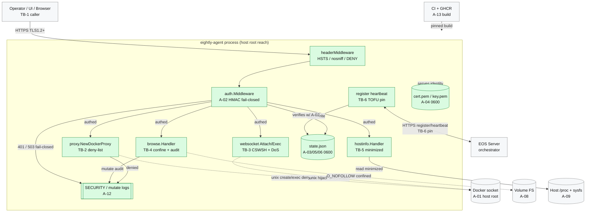

# Data Flow Diagram

All flows into and out of the eightly-agent. Nodes in green are agent-owned code;
grey nodes are external trust domains. Edges are labelled with the protocol and the
control enforced at that crossing. Dashed edges are host-root reach.

## Flow narrative

1. **Inbound API request** (`UI → headerMiddleware → auth.Middleware`). TLS
   terminates at the agent. Headers set, then the HMAC middleware verifies the
   Bearer token. No secret + no opt-out → 503 (fail-closed); bad/absent token →
   401. Both are `[SECURITY]`-logged.
2. **Authenticated request fans out** to one of four host-reaching handlers.
   Each applies its own boundary control *after* auth (defense in depth).
3. **Docker proxy** strips the version prefix, rewrites convenience paths, and —
   on create/exec POSTs — buffers and inspects the body for host-escape config
   before replaying it to the socket.
4. **WebSocket exec/attach** validates the Docker ID, checks Origin (CSWSH),
   enforces the concurrency cap, dials Docker with bounded timeouts, hijacks, and
   bridges with frame-size and idle/absolute timeouts.
5. **Browse** confines every path under the symlink-resolved volume root, opens
   with `O_NOFOLLOW`, and audits all mutations (and read-only rejections).
6. **Outbound to EOS** (register/heartbeat) enforces the TOFU SPKI pin on every
   dial and reads/writes the 0600 state file holding the token and pin.
