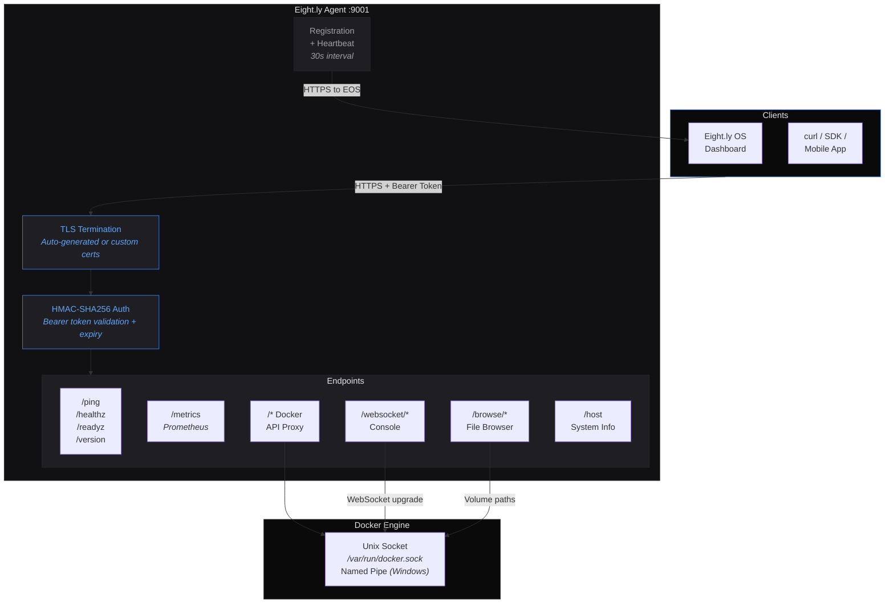

# Architecture



<details markdown="1">
<summary><strong>Package Layout</strong></summary>

```
cmd/agent/
  main.go             — entry point, subcommands, signal handling
  healthcheck.go      — `eightly-agent healthcheck` for container health checks
  service_windows.go  — Windows service (install/uninstall/start/stop/status)
  service_other.go    — stubs for Linux and macOS
internal/auth/jwt.go  — HMAC shared-secret token validation middleware
internal/browse/      — file browser (ls, get, put, delete, rename), confined to each volume
internal/dockerdial/  — connects to Docker: named pipe on Windows, Unix socket elsewhere
internal/config/
  config.go           — CLI flags + env var parsing and validation
  secretfile.go       — --secret-file and --enroll-token-file reading
  defaults_windows.go — Windows default paths (named pipe, ProgramData)
  defaults_other.go   — Linux/macOS default paths (unix socket, /data)
internal/hostinfo/    — PCI + disk detection (sysfs, system_profiler, PowerShell), cached 30s
internal/metrics/     — Prometheus counters/gauges
internal/proxy/       — Docker proxy: allow-list (routes.go), request and target checks
                        (filter.go, policy.go), inspect redaction (redact.go), and the
                        target checks the WebSocket console shares (target.go)
internal/register/    — EOS registration, 30s heartbeat, token renewal, server-cert pinning
internal/server/      — HTTP mux, TLS, registration gate, health check, graceful shutdown
internal/tlsutil/tls.go — self-signed cert generation and reuse
internal/websocket/   — WebSocket attach + exec handlers
internal/winacl/      — Windows access lists for the data folder, state, secret and TLS key
```

</details>

<details markdown="1">
<summary><strong>Dependencies</strong></summary>

| Module | Purpose |
|:-------|:--------|
| `github.com/gorilla/websocket` | WebSocket upgrade for container console |
| `github.com/prometheus/client_golang` | Prometheus metrics (optional, `--metrics` flag) |
| `github.com/rs/zerolog` | Structured JSON logging |
| `golang.org/x/sys` | Windows service management (SCM API) |
| `github.com/Microsoft/go-winio` | Docker's named pipe on Windows |

</details>
