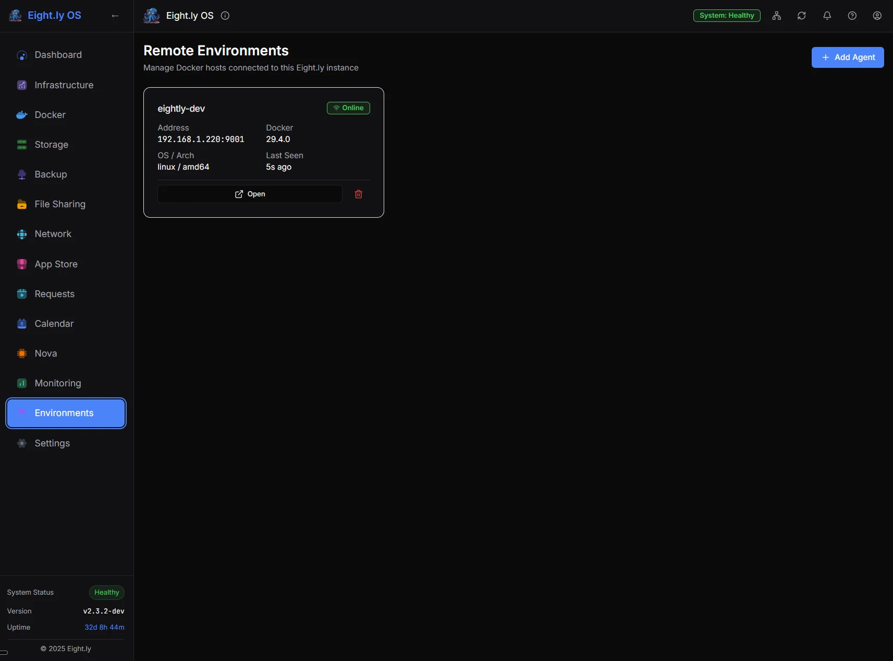
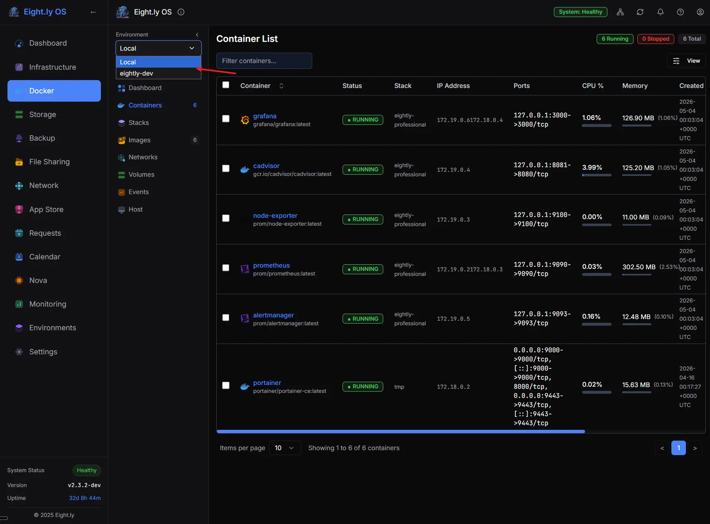
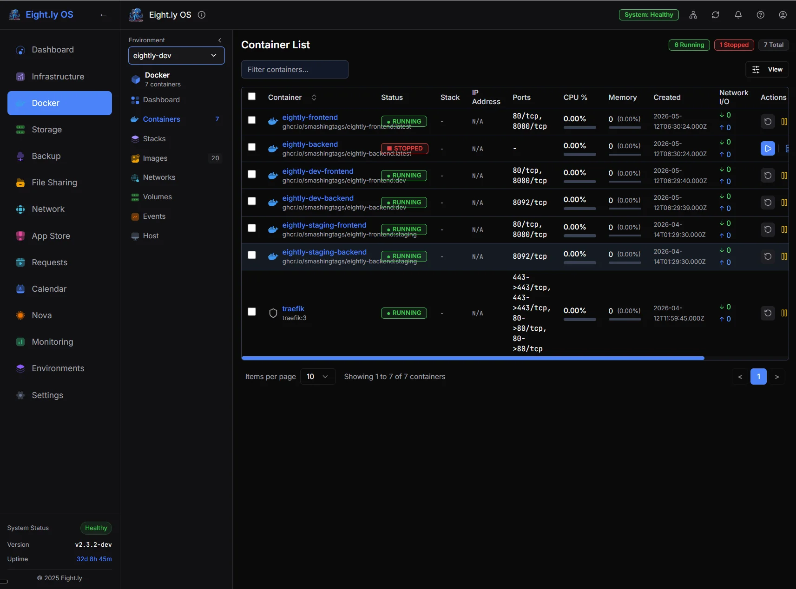
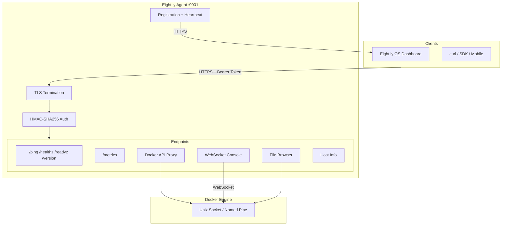

# Eight.ly Agent

Eight.ly Agent is a single Go binary that turns any Docker host into a managed node for Eight.ly OS. Deploy the agent on Linux, macOS, or Windows, point EOS at it, and get full container management, WebSocket console, file browsing, and system monitoring — all over authenticated TLS.

**About 4,800 lines of Go. Five dependencies. Zero config files.**

**One Go binary. Apache 2.0 license. Hardened through security review.** The newest release is on the [Releases](https://github.com/imogenlabs/eightly-agent/releases) page.



Switch between local and remote hosts from the environment dropdown. Every container, on every host, from one UI.

| | |
|---|---|
|  |  |

## Key Capabilities

| Feature | Description |
|---------|-------------|
| Docker API Proxy | Forwards authenticated requests on an allow-list of Docker endpoints to the local Docker socket, refusing requests that would reach the host |
| WebSocket Console | Interactive container attach and exec via WebSocket |
| File Browser | List, upload, download, delete, and rename files in Docker volumes |
| Host Info | Reports PCI devices, physical disks, and system metadata |
| Registration | Enrolls with Eight.ly OS using a one-time enrollment token and sends 30-second heartbeats |
| Auto-TLS | Serves a self-signed cert; pins the EOS server cert on first use (TOFU) |
| Prometheus Metrics | Optional `/metrics` endpoint for monitoring (behind `--metrics` flag) |

## Architecture



The agent sits between the EOS dashboard and the local Docker daemon. All communication from EOS to the agent is over HTTPS with HMAC-SHA256 Bearer token authentication. The agent communicates with Docker via the Unix socket on Linux/macOS or the named pipe (`//./pipe/docker_engine`) on Windows.

## Package Layout

```
cmd/agent/
  main.go               -- entry point, subcommands, signal handling
  healthcheck.go        -- `eightly-agent healthcheck` subcommand for container health checks
  service_windows.go    -- Windows service (install/uninstall/start/stop/status)
  service_other.go      -- stubs for Linux and macOS
internal/auth/jwt.go    -- HMAC shared-secret token validation middleware
internal/browse/        -- file browser (ls, get, put, delete, rename), confined to each volume
internal/config/
  config.go             -- CLI flags + env var parsing and validation
  secretfile.go         -- --secret-file and --enroll-token-file reading
  defaults_other.go     -- Linux/macOS default paths (unix socket, /data)
  defaults_windows.go   -- Windows default paths (named pipe, ProgramData)
internal/hostinfo/      -- PCI devices and physical disks (sysfs, system_profiler, PowerShell), cached 30s
internal/metrics/       -- Prometheus counters and gauges
internal/dockerdial/    -- connects to Docker: named pipe on Windows, Unix socket elsewhere
internal/proxy/
  routes.go             -- the allow-list of Docker methods and paths
  filter.go, policy.go  -- body, bind-root and target-container checks
  redact.go             -- environment values hidden from container inspect
  target.go             -- the same target checks for the WebSocket console
internal/register/
  register.go           -- EOS registration + 30s heartbeat loop
  renew.go              -- token renewal from half-life
  pin.go                -- first-use pinning of the EOS server certificate
  holder.go             -- registration state shared with request handlers
  statedir.go           -- state file and directory permission checks
internal/server/
  server.go             -- HTTP mux, TLS listener, registration gate, graceful shutdown
  healthcheck.go        -- health check pinned to the agent's own certificate
internal/tlsutil/tls.go -- self-signed cert generation and reuse
internal/websocket/     -- WebSocket attach + exec handlers
internal/winacl/        -- Windows access lists for the data folder, state, secret and TLS key
```

About 4,800 lines of Go, not counting tests.

## Dependencies

| Module | Purpose |
|--------|---------|
| `github.com/gorilla/websocket` | WebSocket upgrade for container console |
| `github.com/rs/zerolog` | Structured JSON logging |
| `github.com/prometheus/client_golang` | Prometheus metrics exposition |
| `golang.org/x/sys` | Windows service management and access lists |
| `github.com/Microsoft/go-winio` | Docker's named pipe on Windows |

No frameworks, no ORM, no config libraries.

## Documentation

The [GitHub wiki](https://github.com/imogenlabs/eightly-agent/wiki) is generated; edit `docs/wiki/` in the repository.

**Getting Started**

- [Connect to Eight.ly OS](Installation.md#connect-to-eightly-os) -- From install command to an online host
- [Installation](Installation.md) -- Docker, binary, and build-from-source instructions
- [Upgrading](UPGRADING.md) -- Upgrade steps and security changes
- [Uninstall](Installation.md#uninstall) -- Remove the agent
- [Configuration](Configuration.md) -- All flags and environment variables

**Core Concepts**

- [Architecture](Architecture.md) -- Request flow, package layout, and dependencies
- [Security Model](Security-Model.md) -- Trust, bind roots, and network exposure
- [Authentication](Authentication.md) -- HMAC-SHA256 token validation
- [Registration and Heartbeat](Registration-and-Heartbeat.md) -- How agents register with EOS and maintain connectivity
- [TLS](TLS.md) -- Auto-generated certificates and custom cert support

**Features**

- [API Reference](API-Reference.md) -- Full endpoint documentation with examples
- [File Browser](File-Browser.md) -- Volume file management operations
- [WebSocket Console](WebSocket-Console.md) -- Interactive container console access

**Help**

- [Verifying Releases](Verifying-Releases.md) -- Checksums, signatures, provenance, and SBOM attestations
- [Troubleshooting](Troubleshooting.md) -- Common issues and debug procedures
- [Development](Development.md) -- CI/CD and install methods

## License Commitment

This repository will remain Apache License 2.0 in perpetuity. Future versions of the EOS protocol may be implemented in closed-source server components, but the agent itself will not change license.

Apache License 2.0 — see [LICENSE](https://github.com/imogenlabs/eightly-agent/blob/main/LICENSE) for details.

## Links

- [Eight.ly OS](https://eight.ly)
- [Source on GitHub](https://github.com/imogenlabs/eightly-agent)
- [GitHub Container Registry](https://github.com/imogenlabs/eightly-agent/pkgs/container/eightly-agent)
- [A mirror on Docker Hub](https://hub.docker.com/r/smashingtags/eightly-agent)
- [Imogen Labs](https://imogenlabs.ai)
