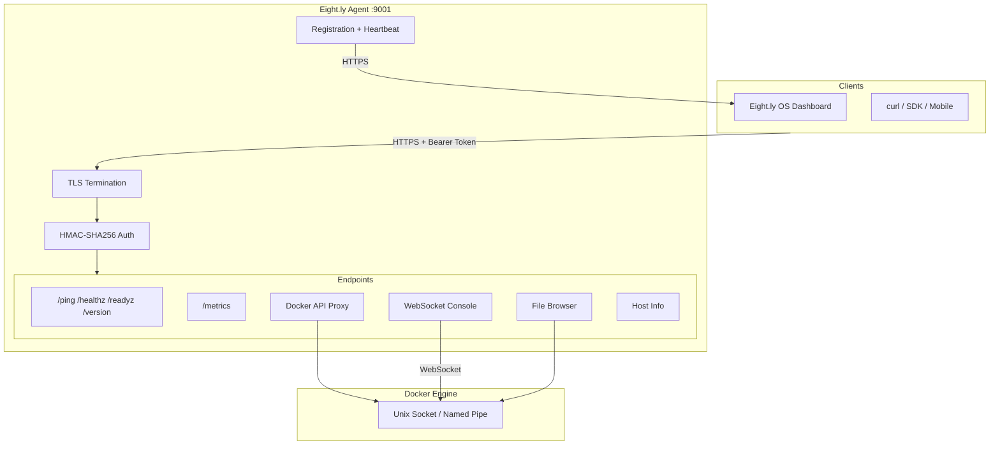

# Eight.ly Agent

Eight.ly Agent is a lightweight, cross-platform Docker management daemon written in Go. It runs on remote Docker hosts (Linux, macOS, and Windows) and lets [Eight.ly OS](https://eight.ly) manage them from a single dashboard. Deploy the agent on any machine with Docker, and EOS gains full container management, WebSocket console access, volume file browsing, and host monitoring -- all over authenticated TLS.

**One Go binary. Apache 2.0 license. Hardened through 6 rounds of security review.** The newest release is on the [Releases](https://github.com/imogenlabs/eightly-agent/releases) page.


| | |
|---|---|
|  |  |

## Key Capabilities

| Feature | Description |
|---------|-------------|
| Docker API Proxy | Forwards authenticated requests to the local Docker socket over HTTPS |
| WebSocket Console | Interactive container attach and exec via WebSocket |
| File Browser | List, upload, download, delete, and rename files in Docker volumes |
| Host Info | Reports PCI devices, physical disks, and system metadata |
| Registration | Auto-registers with Eight.ly OS and sends 30-second heartbeats |
| Auto-TLS | Generates self-signed certificates on first start if none are provided |
| Prometheus Metrics | Optional `/metrics` endpoint for monitoring (behind `--metrics` flag) |

## Architecture



The agent sits between the EOS dashboard and the local Docker daemon. All communication from EOS to the agent is over HTTPS with HMAC-SHA256 Bearer token authentication. The agent communicates with Docker via the Unix socket on Linux/macOS or the named pipe (`//./pipe/docker_engine`) on Windows.

## Package Layout

```
cmd/agent/main.go                  128 LOC -- entry point, HTTP mux, TLS, graceful shutdown
cmd/agent/service_linux.go          -- Linux service (systemd) integration
cmd/agent/service_darwin.go         -- macOS service (launchd) integration
cmd/agent/service_windows.go        -- Windows service (SCM) integration
internal/auth/jwt.go                65 LOC -- HMAC shared-secret token validation middleware
internal/browse/browse.go          143 LOC -- file browser (ls, get, put, delete, rename)
internal/config/config.go           51 LOC -- CLI flags + env var parsing
internal/config/defaults_linux.go   -- Linux platform defaults
internal/config/defaults_darwin.go  -- macOS platform defaults
internal/config/defaults_windows.go -- Windows platform defaults
internal/hostinfo/hostinfo.go       87 LOC -- PCI device and physical disk detection
internal/proxy/docker.go            50 LOC -- reverse proxy to Docker socket
internal/register/register.go      268 LOC -- EOS registration + 30s heartbeat loop
internal/server/server.go           -- HTTP server lifecycle (used by service wrappers)
internal/tlsutil/tls.go             75 LOC -- self-signed cert generation
internal/websocket/ws.go           125 LOC -- WebSocket attach + exec handlers
                                   -----
                                  ~2,050 LOC total
```

## Dependencies

| Module | Purpose |
|--------|---------|
| `github.com/gorilla/websocket` | WebSocket upgrade for container console |
| `github.com/rs/zerolog` | Structured JSON logging |
| `github.com/prometheus/client_golang` | Prometheus metrics exposition |

No frameworks, no ORM, no config libraries.

## Documentation

**Getting Started**

- [Installation](Installation.md) -- Docker, binary, and build-from-source instructions
- [Configuration](Configuration.md) -- All flags and environment variables

**Core Concepts**

- [Authentication](Authentication.md) -- HMAC-SHA256 token validation
- [Registration and Heartbeat](Registration-and-Heartbeat.md) -- How agents register with EOS and maintain connectivity
- [TLS](TLS.md) -- Auto-generated certificates and custom cert support

**Features**

- [API Reference](API-Reference.md) -- Full endpoint documentation with examples
- [File Browser](File-Browser.md) -- Volume file management operations
- [WebSocket Console](WebSocket-Console.md) -- Interactive container console access

**Help**

- [Troubleshooting](Troubleshooting.md) -- Common issues and debug procedures

## Links

- [Eight.ly OS](https://eight.ly)
- [Source on GitHub](https://github.com/imogenlabs/eightly-agent)
- [GitHub Container Registry](https://github.com/imogenlabs/eightly-agent/pkgs/container/eightly-agent)
- [Docker Hub mirror](https://hub.docker.com/r/smashingtags/eightly-agent)
- [Imogen Labs](https://imogenlabs.ai)
